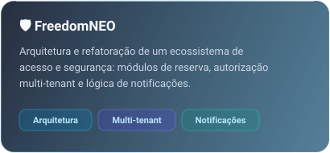
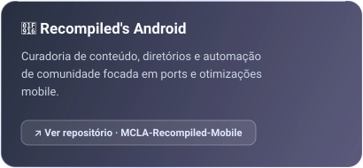
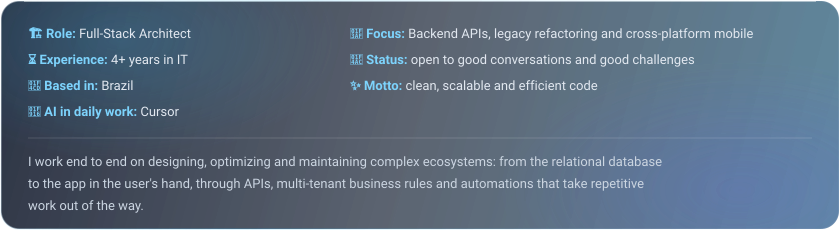
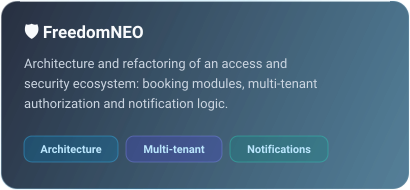
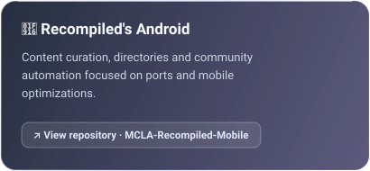

 <b>Português</b>

 

 

 

## 👨‍💻 Sobre mim

  

 

## ⚙️ Linguagens

  

 

| Camada | O que eu entrego |
| :-- | :-- |
| 🧠 **Backend e Sistemas** | APIs, módulos de autorização multi-tenant, regras de reserva e notificações |
| 📱 **Mobile** | Apps com React Native (Expo, NativeWind, Paper) e Delphi FMX |
| 🗄️ **Dados** | Firebird SQL, modelagem, otimização e administração com IBExpert e FireDAC |
| 🏚️ **Legado** | Refatoração segura de sistemas antigos, sem parar a operação |
| 🤖 **IA e Automação** | Fluxos assistidos por IA, scripts Bash e acesso remoto via SSH |
| 🐧 **Android Customizado** | AOSP e LineageOS, ports e otimizações mobile |

 

## 🚀 Em destaque

  
  

 

## 📊 Números

 

 <b>English</b>

 

 

 

## 👨‍💻 About me

  

 

## ⚙️ Languages

  

 

| Layer | What I deliver |
| :-- | :-- |
| 🧠 **Backend & Systems** | APIs, multi-tenant authorization modules, booking rules and notifications |
| 📱 **Mobile** | Apps with React Native (Expo, NativeWind, Paper) and Delphi FMX |
| 🗄️ **Data** | Firebird SQL, modeling, optimization and administration with IBExpert and FireDAC |
| 🏚️ **Legacy** | Safe refactoring of old systems without stopping operations |
| 🤖 **AI & Automation** | AI-assisted workflows, Bash scripts and remote access via SSH |
| 🐧 **Custom Android** | AOSP and LineageOS, ports and mobile optimizations |

 

## 🚀 Featured

  
  

 

## 📊 Numbers

 

## 🐍 Contribuições · Contributions

<picture>
  <source media="(prefers-color-scheme: dark)" srcset="https://raw.githubusercontent.com/dreyranos/dreyranos/output/github-snake-dark.svg" />
  <source media="(prefers-color-scheme: light)" srcset="https://raw.githubusercontent.com/dreyranos/dreyranos/output/github-snake.svg" />
  
</picture>

 

