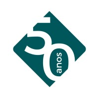
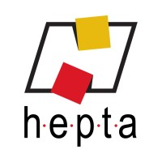
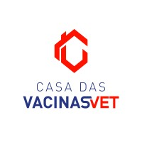

  

  

   

  
  
  

 

## ⚡ Stack & Foco

  <table>
    <tr>
      <td align="center" width="35%">
        
      </td>
      <td width="65%" valign="middle">
        
      </td>
    </tr>
  </table>

 

## ⚙️ Ecossistema

  
    
  
  
  
  
  
  

 

## 💼 Experiência & Formação

<table width="100%">
  <tr>
    <td width="60" align="center" valign="middle">
      
    </td>
    <td valign="middle">
      <b>Desenvolvedor full stack</b> · <code>PROANSI</code> 
      jul. de 2023 - o momento · São José do Rio Preto, SP
    </td>
  </tr>
  <tr>
    <td width="60" align="center" valign="middle">
      
    </td>
    <td valign="middle">
      <b>Analista de Suporte N2</b> · <code>Hepta Tecnologia e Informática</code> 
      out. de 2022 - jun. de 2023 · São José do Rio Preto, SP
    </td>
  </tr>
  <tr>
    <td width="60" align="center" valign="middle">
      
    </td>
    <td valign="middle">
      <b>Gestor de TI</b> · <code>Tesla Marcações Industriais</code> 
      jun. de 2022 - set. de 2022 · São José do Rio Preto, SP
    </td>
  </tr>
  <tr>
    <td width="60" align="center" valign="top">
      
    </td>
    <td valign="middle">
      <b>Casa das Vacinas</b> · 5 anos 6 meses 
      • <b>Desenvolvedor</b> (jan. de 2020 - jun. de 2022) 
      • <b>Assistente de TI</b> (jan. de 2017 - jan. de 2020)
    </td>
  </tr>
  <tr>
    <td width="60" align="center" valign="middle">
      
    </td>
    <td valign="middle">
      <b>Etec Philadelpho Gouvêa Netto</b> · <code>Técnico em TI</code> 
      2014 - 2016
    </td>
  </tr>
</table>

 

## 📊 Métricas & Atividade

  
    
  
    
  <picture>
    <source media="(prefers-color-scheme: dark)" srcset="https://raw.githubusercontent.com/dreyranos/dreyranos/output/github-snake-dark.svg" />
    <source media="(prefers-color-scheme: light)" srcset="https://raw.githubusercontent.com/dreyranos/dreyranos/output/github-snake.svg" />
    
  </picture>

 

## 📡 Conexões

  
  

    

  

