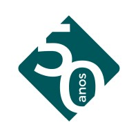
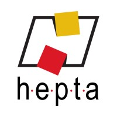

  

 

 

## 👤 Sobre

Desenvolvedor full stack com mais de oito anos de atuação em tecnologia, com experiência sólida em **arquitetura de APIs multi-tenant**, **modernização de sistemas legados** e **desenvolvimento de aplicações mobile e desktop**. Atuação orientada a qualidade de código, desempenho, escalabilidade e entrega de valor para o negócio.

 

## 🎯 Áreas de Atuação

🏗️ **Backend & Arquitetura** — projeto e desenvolvimento de APIs, modelagem multi-tenant, integrações e padronização de serviços.

📱 **Desenvolvimento Mobile** — aplicações com React Native (Expo) e NativeWind, além de soluções em Delphi FMX.

🗄️ **Banco de Dados & Legado** — Firebird SQL, otimização de consultas e refatoração incremental de sistemas legados.

⚙️ **Automação & IA** — scripts em Python e Bash, pipelines de automação e fluxos de trabalho com inteligência artificial.

🐧 **Android Customizado** — customização e build de ROMs com AOSP e LineageOS.

 

## 🛠️ Stack Tecnológica

**Linguagens & Frameworks**

  

**Dados, Infraestrutura & Ferramentas**

 

## 💼 Experiência Profissional

  
  <b>Desenvolvedor Full Stack</b> &nbsp; 
  <code>PROANSI</code> · jul. 2023 – presente · 3 anos 5 meses · São José do Rio Preto, SP

 

  
  <b>Analista de Suporte N2</b> 
  <code>Hepta Tecnologia e Informática</code> · out. 2022 – jun. 2023 · 9 meses · São José do Rio Preto, SP

 

  
  <b>Gestor de TI</b> 
  <code>Tesla Marcações Industriais</code> · jun. 2022 – set. 2022 · 4 meses · São José do Rio Preto, SP

 

  
  <b>Casa das Vacinas</b> &nbsp; 
  ↳ <b>Desenvolvedor</b> · jan. 2020 – jun. 2022 · 2 anos 6 meses 
  ↳ <b>Assistente de TI</b> · jan. 2017 – jan. 2020 · 3 anos 1 mês

 

---

## 🎓 Formação Acadêmica

  
  <b>Etec Philadelpho Gouvêa Netto</b> 
  <code>Curso Técnico Integrado em Tecnologia da Informação</code> · 2014 – 2016

 

---

## 📊 Estatísticas do GitHub

  

  

<picture>
  <source media="(prefers-color-scheme: dark)" srcset="https://raw.githubusercontent.com/dreyranos/dreyranos/output/github-snake-dark.svg" />
  <source media="(prefers-color-scheme: light)" srcset="https://raw.githubusercontent.com/dreyranos/dreyranos/output/github-snake.svg" />
  
</picture>

 

## 📬 Contato

Aberto a projetos, parcerias e novas oportunidades profissionais.

 

  

