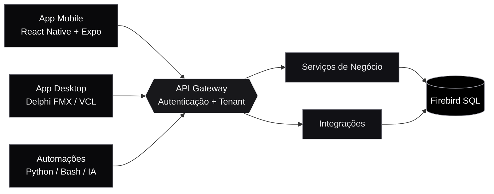
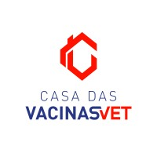
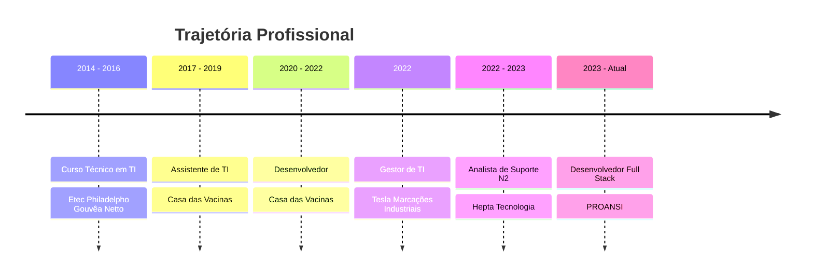

<div align="center">


<a href="https://dreyranos.github.io">
  
</a>

<br/><br/>


<br/><br/>

<a href="https://dreyranos.github.io">
  
</a>
<a href="https://wa.me/5517992083142">
  
</a>
<a href="mailto:andreyranos@gmail.com">
  
</a>
<a href="https://www.linkedin.com/in/andrey-ramos-6302722a3">
  
</a>

<br/>


<br/><br/>

<a href="#-sobre"><kbd>Sobre</kbd></a> ·
<a href="#-áreas-de-atuação"><kbd>Atuação</kbd></a> ·
<a href="#-arquitetura-de-referência"><kbd>Arquitetura</kbd></a> ·
<a href="#-stack-tecnológica"><kbd>Stack</kbd></a> ·
<a href="#-experiência-profissional"><kbd>Experiência</kbd></a> ·
<a href="#-formação-acadêmica"><kbd>Formação</kbd></a> ·
<a href="#-desenvolvimento--deploy-na-vercel"><kbd>Vercel</kbd></a> ·
<a href="#-contato--oportunidades"><kbd>Oportunidades</kbd></a>

</div>

<br/>

> [!TIP]
> **Porta de Entrada para Novas Oportunidades:** Confira meu portfólio interativo em React 19, TypeScript, Tailwind CSS v4, D3.js e Motion em **[dreyranos.github.io](https://dreyranos.github.io)** (pronto para deploy contínuo na **Vercel**) ou fale diretamente pelo **[WhatsApp](https://wa.me/5517992083142)**, **[E-mail](mailto:andreyranos@gmail.com)** e **[LinkedIn](https://www.linkedin.com/in/andrey-ramos-6302722a3)**.

<br/>

## 👤 Sobre


<p>
  
  Desenvolvedor full stack com <b>mais de nove anos de atuação em tecnologia</b>, construindo e sustentando sistemas que operam em produção. Minha experiência combina <b>arquitetura de APIs multi-tenant</b>, <b>modernização de sistemas legados</b> e <b>desenvolvimento de aplicações web, mobile e desktop</b>, sempre com foco em qualidade de código, desempenho, escalabilidade e valor entregue ao negócio.
  <br/><br/>
  <b>Princípios de engenharia:</b> código legível, decisões documentadas, mudanças incrementais e automação de tudo que for repetitivo.
</p>

<br clear="right" />

<br/>

## 🎯 Áreas de Atuação


### `◈ 01` · Backend & Arquitetura
> Construção de **APIs em Delphi com Horse** e em **C# .NET**, modelagem multi-tenant com isolamento por cliente, integrações corporativas e padronização de serviços distribuídos.
>
> `↳` <kbd>Delphi Horse</kbd> <kbd>C# .NET</kbd> <kbd>APIs Multi-Tenant</kbd> <kbd>Integrações</kbd>

<br/>

### `◈ 02` · Web, Mobile & Desktop
> Interfaces web modernas com **Angular e React**, aplicativos multiplataforma com **React Native (Expo) + NativeWind** e aplicações desktop robustas em **Delphi VCL e FMX**.
>
> `↳` <kbd>React Native (Expo)</kbd> <kbd>NativeWind</kbd> <kbd>React</kbd> <kbd>Angular</kbd> <kbd>Delphi FMX / VCL</kbd>

<br/>

### `◈ 03` · Banco de Dados & Legado
> Especialização em **Firebird SQL**, análise e otimização de consultas críticas e refatoração incremental de sistemas legados mantendo a operação 100% estável.
>
> `↳` <kbd>Firebird SQL</kbd> <kbd>Query Tuning</kbd> <kbd>Refatoração de Legado</kbd>

<br/>

### `◈ 04` · Automação & Fluxos com IA
> Scripts avançados em **Python e Bash**, criação de pipelines de automação operacional e orquestração de fluxos de trabalho inteligentes com **IA**.
>
> `↳` <kbd>Python</kbd> <kbd>Bash</kbd> <kbd>Automação de Processos</kbd> <kbd>Fluxos com IA</kbd>

<br/>

### `◈ 05` · Android Customizado
> Customização em baixo nível, ajustes de sistema e build de ROMs Android sob medida com **AOSP** e **LineageOS**.
>
> `↳` <kbd>AOSP</kbd> <kbd>LineageOS</kbd> <kbd>Custom ROM Builds</kbd>

<br/>

## 🧩 Arquitetura de Referência


Modelo que resume o tipo de solução em que mais atuo: clientes múltiplos consumindo uma API multi-tenant com isolamento por tenant sobre uma camada de dados legada e modernizada.



<br/>

## 🛠️ Stack Tecnológica


<div align="center">

<br/>


<p align="center">
  
  
  
  
  
  
  
  
  
  
  
  
  
  
</p>


<p align="center">
  
  
  
  
  
  
  
</p>


<p align="center">
  
  
  
  
</p>

</div>

<br/>

## 💼 Experiência Profissional


<p>
  
  <b>Desenvolvedor Full Stack</b> &nbsp;<br/>
  <code>PROANSI</code> · <sub>jul. 2023 – presente · 3 anos 5 meses · São José do Rio Preto, SP</sub>
</p>

<br clear="left" />

<p>
  
  <b>Analista de Suporte N2</b><br/>
  <code>Hepta Tecnologia e Informática</code> · <sub>out. 2022 – jun. 2023 · 9 meses · São José do Rio Preto, SP</sub>
</p>

<br clear="left" />

<p>
  
  <b>Gestor de TI</b><br/>
  <code>Tesla Marcações Industriais</code> · <sub>jun. 2022 – set. 2022 · 4 meses · São José do Rio Preto, SP</sub>
</p>

<br clear="left" />

<p>
  
  <b>Casa das Vacinas</b> &nbsp;<br/>
  ↳ <b>Desenvolvedor</b> · <sub>jan. 2020 – jun. 2022 · 2 anos 6 meses</sub><br/>
  ↳ <b>Assistente de TI</b> · <sub>jan. 2017 – jan. 2020 · 3 anos 1 mês</sub>
</p>

<br clear="left" />

<details>
<summary><b>📈 Ver linha do tempo da carreira</b></summary>

<br/>



</details>

<br/>

## 🎓 Formação Acadêmica


<p>
  
  <b>Etec Philadelpho Gouvêa Netto</b><br/>
  <code>Curso Técnico Integrado em Tecnologia da Informação</code> · <sub>2014 – 2016</sub>
</p>

<br clear="left" />

<br/>

## 📊 Atividade no GitHub


<div align="center">


<br/><br/>


<br/><br/>

<picture>
  <source media="(prefers-color-scheme: dark)" srcset="https://raw.githubusercontent.com/dreyranos/dreyranos/output/puzzle-bobble-contribution-graph-dark.svg" />
  <source media="(prefers-color-scheme: light)" srcset="https://raw.githubusercontent.com/dreyranos/dreyranos/output/puzzle-bobble-contribution-graph.svg" />
  
</picture>

</div>

<br/>

## 🚀 Desenvolvimento & Deploy na Vercel


Este repositório contém o código-fonte do portfólio web em **React 19 + TypeScript + Vite + Tailwind CSS v4**, com:
- Gráficos **D3.js** de frequência de commits e mapa anual de contribuições (`GitHubCommitChart` + `ContributionGraph`)
- Busca e filtro por tags em **Projetos**, tempo estimado de leitura e hover cards animados com **Motion**
- **SEO & Open Graph** via `@dr.pogodin/react-helmet`, rota **404** integrada, exportação para **PDF (`@media print`)**, **Newsletter** no rodapé e alternador bilíngue (**PT / EN**) + tema **Claro / Escuro**
- Monitoramento de **Core Web Vitals**, **NeuralCanvas** reativo ao cursor/toque e controle opcional de som ambiente

<details>
<summary><b>⚙️ Comandos locais e publicação na Vercel</b></summary>

```bash
# Instalar dependências
npm install

# Executar em desenvolvimento (http://localhost:3000)
npm run dev

# Verificar tipagem TypeScript
npm run lint

# Gerar build de produção (dist/)
npm run build
```

**Deploy na Vercel (`vercel.json` já configurado):**
1. Envie o repositório para o GitHub (`git push -u origin main`).
2. Importe o projeto em **[vercel.com/new](https://vercel.com/new)** (preset **Vite**, build `npm run build`, saída `dist`).
3. *(Opcional)* Defina `VITE_NEWSLETTER_ENDPOINT` se desejar apontar o formulário do rodapé para o Formspree em vez do FormSubmit padrão (`andreyranos@gmail.com`).
4. Ou publique direto pelo terminal com `npx vercel --prod`.

</details>

<br/>

## 📬 Contato & Oportunidades


> [!IMPORTANT]
> **Vamos construir algo em produção?** Aberto a **novas oportunidades profissionais**, **projetos sob demanda**, **parcerias técnicas** e **consultoria em modernização de sistemas legados**.
>
> - **WhatsApp:** [(17) 99208-3142](https://wa.me/5517992083142)
> - **E-mail:** [andreyranos@gmail.com](mailto:andreyranos@gmail.com)

<div align="center">

<br/>

<a href="https://dreyranos.github.io">
  
</a>
<a href="https://wa.me/5517992083142">
  
</a>
<a href="mailto:andreyranos@gmail.com">
  
</a>
<a href="https://www.linkedin.com/in/andrey-ramos-6302722a3">
  
</a>
<a href="https://github.com/dreyranos">
  
</a>

<br/><br/>


</div>
